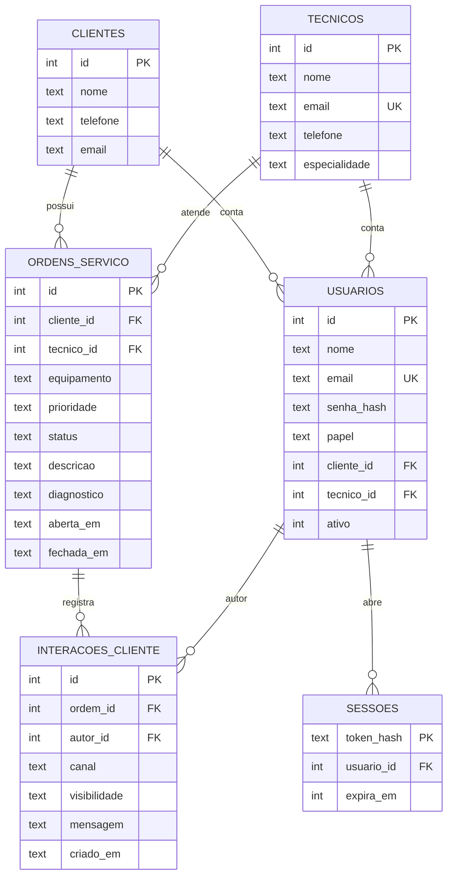
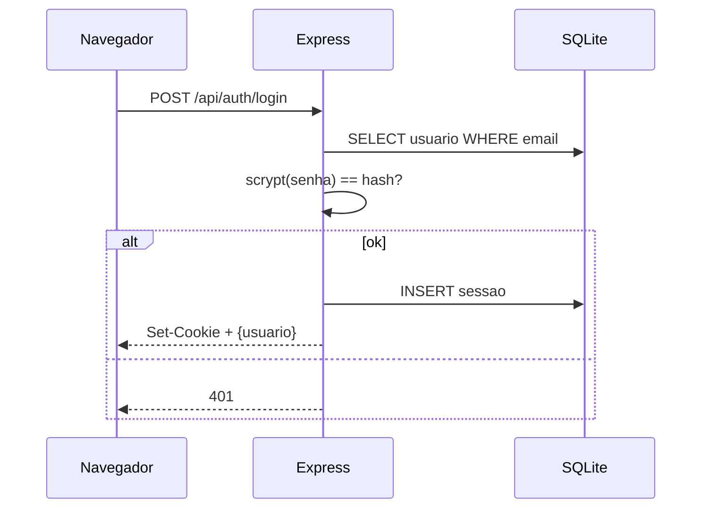
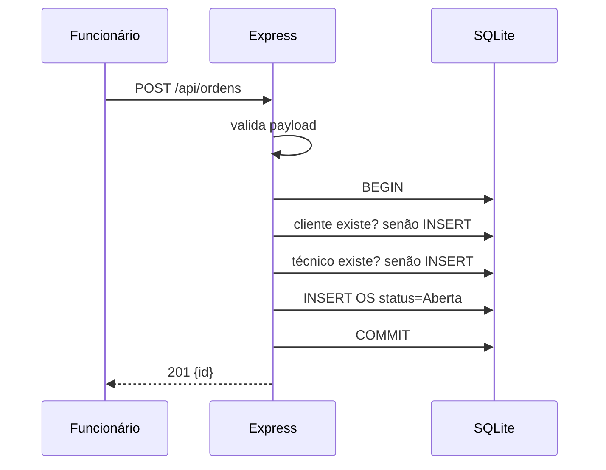

# Arquitetura

## Visão geral

```
Navegador (HTML/CSS/JS)
   │  fetch + Cookie os_session
   ▼
Express 5
   ├─ Middleware req.user
   ├─ Middleware exigirPapeis
   └─ Rotas /api/*
   │  better-sqlite3 (síncrono)
   ▼
SQLite (os_system.sqlite)
```

## ER



## Login



## Criação de OS



## Decisões

| Decisão | Motivo |
|---|---|
| `better-sqlite3` | Simples, síncrono, sem pool |
| Sessão em cookie HttpOnly | Imune a XSS/CSRF sem dependência externa |
| `scrypt` + salt | Padrão do Node |
| Sem framework no front | Domínio de JS/DOM |
| `exigirPapeis` centralizado | Não esquece autorização em endpoints novos |
| Validação antes do SQL | 400 com mensagem clara em vez de 500 |
| DELETE de OS só após concluir | Preserva histórico |
| `corpoSeguro(req)` | Express 5 deixa body `undefined` sem Content-Type |